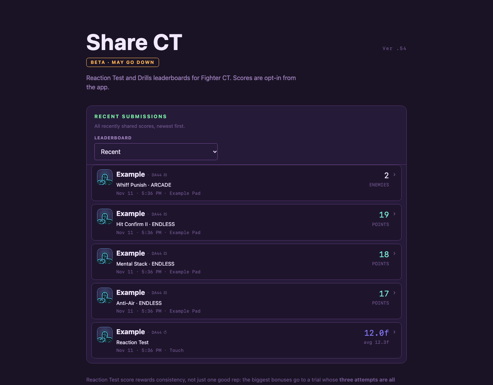
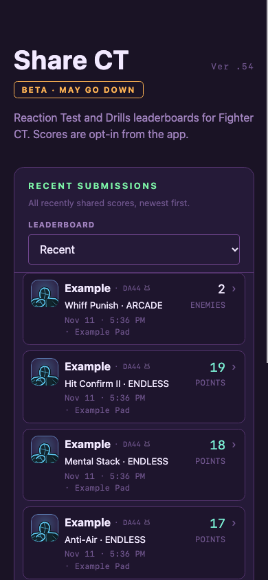

# Website all-score Recent

The existing leaderboard dropdown gains **Recent**. It shows Reaction and explicitly published Drills runs across original/curriculum/Mental Stack Endless and Arcade, newest first. It adds no app-side change or new collection, stored field, publication consent, or historical best-only backfill.

The website calls GET `/v1/activity?limit=50`: two bounded reads, each capped before merging. Drills use indexed, retention-bounded run tables and current player presentation. Best-only rows are excluded. The typed existing public entry serializers carry score facts and only public identifiers. A stable merge chooses the newest global limit; same-second ties retain source order. Rows have no standing, medal or rank number. Existing page-owned visible Recent refresh is reused.

Local gofmt, go vet ./..., go test ./... and 24 Node tests pass. Integration coverage includes cross-type chronology, original/curriculum/Mental Stack categories, both modes, idempotent submissions, best-only exclusion, expired drill rows, global cap/invalid limits, private-field exclusion and complete identity deletion. Actual Chrome renders the local server with five fixture entries at1280x1000 and390x844; asserts type labels, chronology markers, hidden irrelevant controls, no horizontal overflow and restoring the ordinary board controls. Only local fixture data was created; no live test score or account.

Retained preparation failures: an unused test import was caught by vet; the first browser fixture supplied an incorrect Reaction score claim and was rejected as designed. Corrected fixture uses the unchanged score formula. No production assertion was weakened. The predecessor validator migration tests separately exposed and fixed the actual database range constraint.

